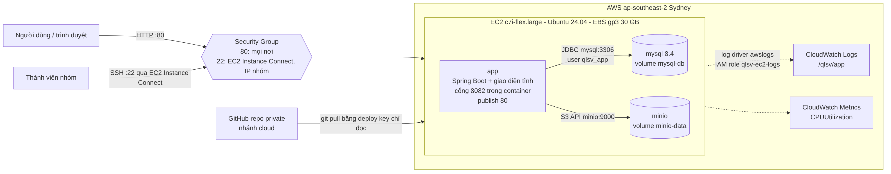
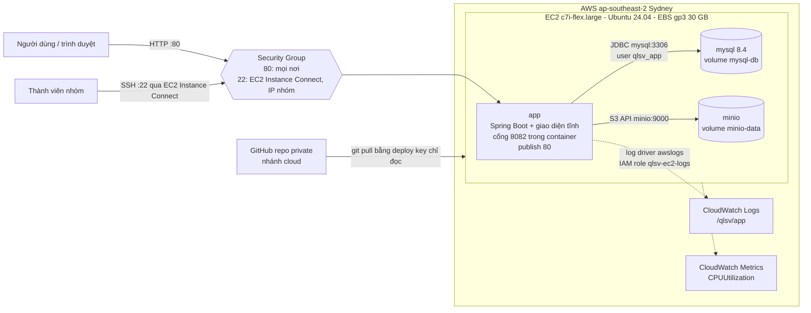

# Kiến trúc triển khai (giai đoạn giữa kỳ)

Một máy ảo EC2 (Ubuntu 24.04) trên AWS region Sydney chạy 3 container bằng Docker Compose.
Chỉ cổng 80 (HTTP) mở cho Internet; cổng 22 (SSH) chỉ cho dịch vụ EC2 Instance Connect và IP của nhóm.
Log của app được gửi lên Amazon CloudWatch Logs; CPU của VM xem trên CloudWatch Metrics.

| Thành phần | Vai trò | Mở ra Internet? |
|---|---|---|
| `app` | REST API, xác thực JWT, phục vụ giao diện HTML/JS, endpoint `/health` | Có, qua cổng 80 |
| `mysql` | Lưu khoa, lớp, sinh viên, niên khóa, tài khoản, metadata tài liệu | Không (3306 không publish) |
| `minio` | Lưu file tài liệu tải lên | Không (Console chỉ trên 127.0.0.1, xem qua SSH tunnel) |
| `.env` trên VM | Mật khẩu DB, khóa JWT, khóa MinIO (sinh ngẫu nhiên bằng `scripts/gen-env.sh`) | Không, quyền 600, không nằm trong Git |
| CloudWatch Logs `/qlsv/app` | Log ứng dụng, mỗi request một dòng, giữ 7 ngày | Chỉ xem trong AWS console |
| IAM role `qlsv-ec2-logs` | Cho EC2 ghi log lên CloudWatch, không cần access key trên VM | — |

Luồng một request: trình duyệt → Security Group (cổng 80) → container `app` → kiểm tra JWT và quyền → truy vấn `mysql`
bằng tài khoản riêng `qlsv_app` (không phải root) → trả JSON; dòng log của request được gửi lên CloudWatch.

Hướng mở rộng cuối kỳ (chưa làm): tách MySQL sang Amazon RDS, file sang S3 (`storage-comparison.md`); HTTPS bằng reverse proxy và tên miền; CI/CD.
