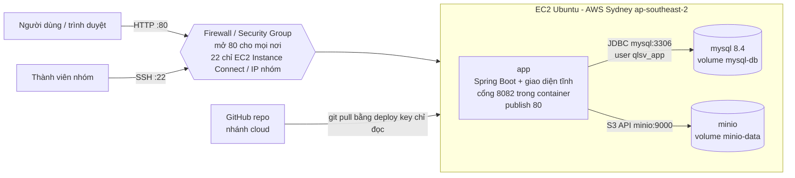

# Kiến trúc triển khai (giai đoạn giữa kỳ)

Một máy ảo EC2 (Ubuntu) trên AWS chạy 3 container bằng Docker Compose. Chỉ cổng 80 (HTTP) mở cho Internet; cổng 22 (SSH) chỉ cho dịch vụ EC2 Instance Connect hoặc IP của nhóm.

| Thành phần | Vai trò | Mở ra Internet? |
|---|---|---|
| `app` | REST API, xác thực JWT, phục vụ giao diện HTML/JS, endpoint `/health` | Có, qua cổng 80 |
| `mysql` | Lưu khoa, lớp, sinh viên, niên khóa, tài khoản, metadata tài liệu | Không |
| `minio` | Lưu file tài liệu tải lên | Không (Console chỉ trên 127.0.0.1, xem qua SSH tunnel) |
| `.env` trên VM | Mật khẩu DB, khóa JWT, khóa MinIO | Không, quyền 600, không nằm trong Git |

Luồng một request: trình duyệt → firewall (cổng 80) → container `app` → kiểm tra JWT và quyền → truy vấn `mysql` bằng tài khoản riêng `qlsv_app` (không phải root) → trả JSON. Mỗi request được ghi một dòng log (`docker compose logs app`).

Hướng mở rộng cuối kỳ (chưa làm): tách MySQL sang database được quản lý (ví dụ Amazon RDS) trong mạng riêng; HTTPS bằng reverse proxy; đưa log lên dịch vụ log của nhà cung cấp.
